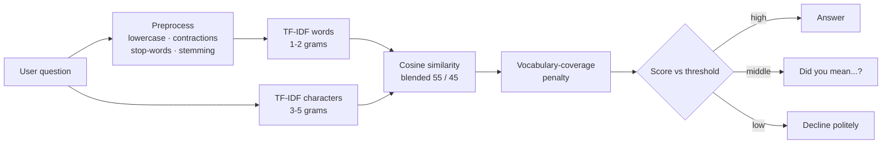

<div align="center">

# CodeAlpha AI Internship · Engineering Notebook

**Three shipped AI apps. One tested core. Every number in this README is reproducible with one command.**

[](https://codealpha-translator.streamlit.app/)
[](https://codealpha-chatbotai.streamlit.app/)
[](https://codealpha-objectdetection.streamlit.app/)

  

**Viniska K S** · Data Science, T John Institute of Technology · [GitHub @viniska13](https://github.com/viniska13)
CodeAlpha Artificial Intelligence Internship · 10 Oct – 10 Nov 2026 · ID `CA/DF1/316933`

</div>

---

## The idea

Most internship repos are three notebooks glued to a UI. This one is built the other way round:

> **Each task is a small, UI-independent engine in `core/` with unit tests. Streamlit is only a thin skin on top.**

That is why the logic can be tested without a browser, a GPU or the internet, and why it runs the same in CI as on my laptop.

| | Task | What it does | The part I'm proudest of |
|---|---|---|---|
| 🌐 | **1 · Lexicon**: translator | 47 languages, auto-detect, long text, speech | A fallback chain that survives a provider failing, and a built-in **health check** that tells you which one broke |
| 💬 | **2 · Docket**: FAQ chatbot | Answers questions about this internship | An **Inspector panel** that shows *why* it answered, and an evaluation tab with a **held-out** test set |
| 🎯 | **4 · Vision Lab**: detection + tracking | YOLOv8 on images, video and webcam | **SORT tracker written from scratch** (Kalman filter + Hungarian matching), not imported |

---

## Task 1 · Lexicon: translation that explains itself

**Live:** https://codealpha-translator.streamlit.app/

- **47 languages**, offline language detection with a confidence score (`langdetect`)
- **Engine fallback:** Google Translate → MyMemory (→ Google Cloud API first, if you add a key). If one engine is blocked, rate-limited or returns garbage, the next one takes over, and the result tells you which one answered
- **Long-text safe:** text is split on paragraph and sentence boundaries to each engine's own size limit, then stitched back with the layout preserved
- **Retries with backoff** on timeouts and 429/5xx errors; API keys are scrubbed from error messages
- Text-to-speech (`gTTS`), copy and download, a **Compare** tab, a **Phrasebook**, a session history
- **System health panel:** one click tests every engine and reports `OK` or `FAILED` with the reason

**Why direct HTTP and not a wrapper library?** My first version used a scraping wrapper and broke whenever the upstream HTML or language codes changed. Calling the endpoints directly gives me control over timeouts, retries and error handling, and makes every failure mode testable with a fake.

---

## Task 2 · Docket: a chatbot you can interrogate

**Live:** https://codealpha-chatbotai.streamlit.app/

Docket answers questions about this very internship (dates, tasks, submission, certificate, LOR). It is **retrieval-based on purpose**: every reply is a curated entry, so it cannot invent a deadline.



**Design decisions**

| Problem | Decision |
|---|---|
| Users make typos ("certifcate") | A second index on **character n-grams** tolerates misspellings |
| TF-IDF silently ignores unknown words, so "explain quantum computing" collapses to "explain" and matches something | A **vocabulary-coverage penalty** pushes off-topic questions down |
| One threshold fits nobody | Three outcomes: answer / suggest / decline, with a live **threshold slider** |
| "Trust me, it works" | An **Inspector** shows cleaned tokens, word and character cosine scores, the matched phrasing and the decision gauge |

### Honest evaluation

Run it yourself: `python scripts/evaluate_chatbot.py`. The app has the same table in its **Evaluation** tab.

| Query set | Questions | Top-1 | Top-3 | Off-topic declined |
|---|---|---|---|---|
| Tuning set (used to pick the threshold) | 40 + 8 off-topic | 92.5 % | 100 % | 100 % |
| **Held-out set (written after tuning, never tuned on)** | 20 + 6 off-topic | **75 %** | **95 %** | **100 %** |

I report the held-out number as the real one. The gap between 92.5 % and 75 % is the cost of tuning on a small set, and the misses are listed in the app. Most are paraphrases such as *"are you a bot"* or *"list everything I have to do"*. Low-confidence questions get "did you mean…" buttons, so a near-miss is one click from the right answer.

---

## Task 4 · Vision Lab: detection + tracking, with the tracker built by hand

**Live:** https://codealpha-objectdetection.streamlit.app/

- **Image, video and webcam-snapshot** inputs; **YOLOv8n/s/m** selectable (n is bundled)
- Every object gets a **persistent ID**, a **motion trail** and a label
- **Line-crossing counter** (in / out, each ID counted once)
- Per-class unique-object counts, plus downloads: annotated **PNG**, tracked **MP4 (H.264)** and a per-frame **CSV log**
- `scripts/webcam_tracker.py` runs real-time webcam tracking on your own machine

### SORT, from scratch (`core/sort_tracker.py`)

I implemented SORT (Bewley et al., 2016) rather than importing it:

1. A **constant-velocity Kalman filter** per object predicts where its box will be next frame
2. The **Hungarian algorithm** matches predictions to new detections by IoU
3. Matching is **class-aware**, so a "car" can't steal a "person"'s ID
4. Unmatched detections start new tracks. Tracks unseen for `max_age` frames die. An ID is shown only after `min_hits` confirmations, so one-frame false positives never get one

**How it's tested without a GPU:** the tracker and video pipeline run against a *fake detector* that finds a moving white square. The tests check that identity persists through motion and short occlusion, that two crossing objects keep separate IDs, and that the line counter counts a crossing exactly once, all through a real H.264 encode → decode round trip.

---

## Architecture

```text
app.py                 Task 1 UI (Lexicon)
chatbot.py             Task 2 UI (Docket)
object_detection.py    Task 4 UI (Vision Lab)

core/                  pure logic, no Streamlit
  translation.py         chunking · detection · engine fallback · TTS · health check
  faq_engine.py          preprocessing · hybrid TF-IDF · confidence logic · evaluate()
  sort_tracker.py        Kalman filter · Hungarian assignment · track lifecycle
  detection.py           YOLO wrapper · drawing · line counter · video pipeline
  ui.py                  shared Streamlit helpers

data/                  faqs.json · eval_queries.json · holdout_queries.json
scripts/               webcam_tracker.py · evaluate_chatbot.py
tests/                 38 unit tests · no network, no GPU, no weights
.github/workflows/     CI runs the tests and the chatbot evaluation on every push
```

## Quality bar

- **38 unit tests** (translation, FAQ engine, SORT, video pipeline). HTTP and the detector are replaced by fakes, so the tests are fast and deterministic and cover failures that are hard to trigger on demand
- **CI on every push** runs the tests and the chatbot evaluation
- **Reproducible claims:** every accuracy number above comes from `scripts/evaluate_chatbot.py`

## Run it locally

```bash
git clone https://github.com/viniska13/codealpha_tasks.git
cd codealpha_tasks
pip install -r requirements.txt

streamlit run app.py                 # Task 1
streamlit run chatbot.py             # Task 2
streamlit run object_detection.py    # Task 4

python scripts/webcam_tracker.py                          # real-time webcam, q to quit
python scripts/webcam_tracker.py --source clip.mp4 --save out.mp4 --classes person car
python scripts/evaluate_chatbot.py                        # chatbot accuracy
python -m unittest discover -s tests -v                   # 38 tests
```

## Known limits (because every system has them)

- Translation and text-to-speech need internet. They call free public endpoints (Google Translate, MyMemory, gTTS) that can rate-limit; that is exactly why the fallback chain and health check exist
- Docket knows only the internship FAQ set. Paraphrases far from the stored phrasings can miss (see the held-out result)
- Video tracking runs on CPU. On free cloud hosting, use the *frame stride* and *max frames* sliders. Locally it is much faster
- SORT uses motion and box overlap only, with no appearance features, so it can swap IDs after long occlusions. Deep SORT (adding an appearance model) is the natural next step

## What I'd build next

- Deep SORT-style appearance embeddings to keep IDs through long occlusions
- A semantic-embedding retriever for Docket, compared head-to-head with TF-IDF on the same held-out set
- A per-engine latency and success-rate chart in Lexicon's health panel

## Demo

<!-- TODO: add 2-3 screenshots, e.g.  -->
<!-- TODO: add your LinkedIn video link -->

---

<div align="center">
Built for the CodeAlpha AI Internship · <b>Viniska K S</b> · <code>CA/DF1/316933</code>
</div>
